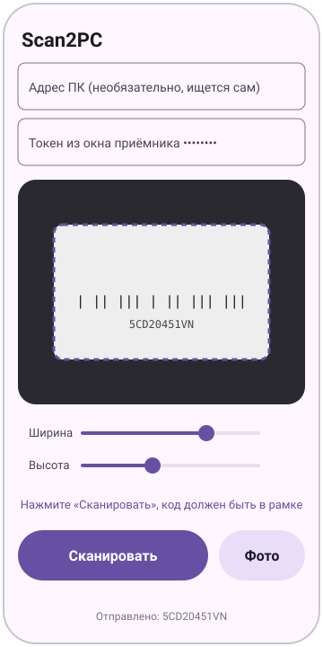
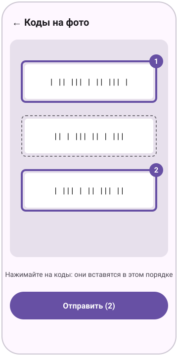
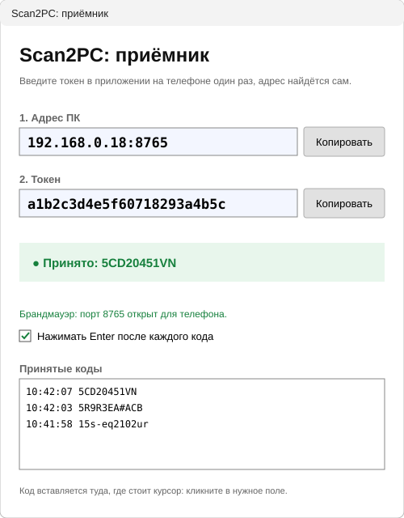

<div align="center">


# Scan2PC

**Телефон как беспроводной сканер штрихкодов для ПК.**
Наведите камеру на код, он сам «напечатается» на компьютере там, где стоит курсор, и нажмётся Enter.

[](#установка)
[](#)
[](#)
[](LICENSE)
[](https://www.donationalerts.com/r/hashonq1)

</div>

---

## Возможности

- 📷 **Сканирование камерой.** Рамка области с ползунками «Ширина» и «Высота»; одно нажатие «Сканировать» = один код.
- 🖼️ **Коды с фото.** Выберите несколько снимков, отметьте нужные коды прямо на фото: вставятся в порядке нажатий.
- ⌨️ **Ввод на ПК.** Приёмник печатает каждый код в активное окно и нажимает Enter (можно отключить).
- 🔎 **Автоподключение.** Токен вводится один раз; если IP ПК сменился, телефон сам находит его в сети.
- 🎨 **Material 3.** Динамические цвета, адаптивная иконка с поддержкой тематических иконок Android 13+.
- 🔒 **Защита токеном.** Без него никто в сети не сможет печатать на вашем ПК.

## Как это выглядит

<div align="center">

&nbsp;

<br><br>

</div>

> Изображения выше: схематичные макеты интерфейса.

## Как это работает

```
 Телефон (Scan2PC) ──HTTP POST /scan, X-Token──▶ ПК (receiver.ps1) ──SendInput──▶ активное окно
        камера + ML Kit                          порт 8765, Wi-Fi                  текст + Enter
```

## Установка

### 1. Приёмник на ПК (Windows)

1. Скачайте репозиторий и откройте папку `pc`.
2. Запустите **`start-receiver.bat`** (двойной щелчок). Откроется окно с **адресом** и **токеном**.
3. Если телефон не подключается, нажмите «Разрешить» в окне: откроется порт `8765` в брандмауэре Windows.

> Нужен Windows 10/11 и встроенный PowerShell, ничего устанавливать не надо.

### 2. Приложение на телефоне (Android 7.0+)

1. Скачайте `Scan2PC.apk` из раздела [Releases](../../releases/latest).
2. Разрешите установку из неизвестных источников и установите APK.
3. Телефон и ПК должны быть **в одной сети Wi-Fi**.

## Использование

1. Откройте приложение и введите **токен** из окна приёмника. Это нужно **один раз**, адрес ПК находится автоматически.
2. Кликните на ПК в поле, куда нужно вставить код.
3. **Камера:** наведите рамку на код и нажмите **«Сканировать»**.
4. **Фото:** нажмите **«Фото»**, выберите снимки, тапайте по нужным кодам (цифры показывают порядок) и нажмите **«Отправить»**.

## Частые вопросы

| Проблема | Решение |
|---|---|
| «ПК не найден в сети» | Запущен ли приёмник? Телефон и ПК в одной Wi-Fi? Порт 8765 разрешён в брандмауэре? |
| «Неверный токен» | Скопируйте токен из окна приёмника заново |
| Код пришёл, но не вставился | Окно приёмника было активным: кликните в нужное поле на ПК |
| Автопоиск не срабатывает | Укажите адрес вручную в формате `192.168.0.18:8765` |

## Сборка из исходников

Нужны Android Studio (JDK 17+) и Android SDK 36.

```bash
cd android
gradle assembleDebug
# APK: android/app/build/outputs/apk/debug/app-debug.apk
```

Стек: Kotlin, Material 3, CameraX, ML Kit Barcode Scanning; приёмник: PowerShell + WinForms.

## Безопасность

Передача идёт по HTTP внутри локальной сети и защищена токеном. Не открывайте порт 8765 в интернет и не публикуйте файл `pc/token.txt`.

## Поддержать проект

Scan2PC бесплатный и с открытым кодом. Если он вам пригодился, можно по желанию отправить благодарность:
**[donationalerts.com/r/hashonq1](https://www.donationalerts.com/r/hashonq1)**. Донаты добровольные и ничего не открывают.

## Лицензия

[MIT](LICENSE)
